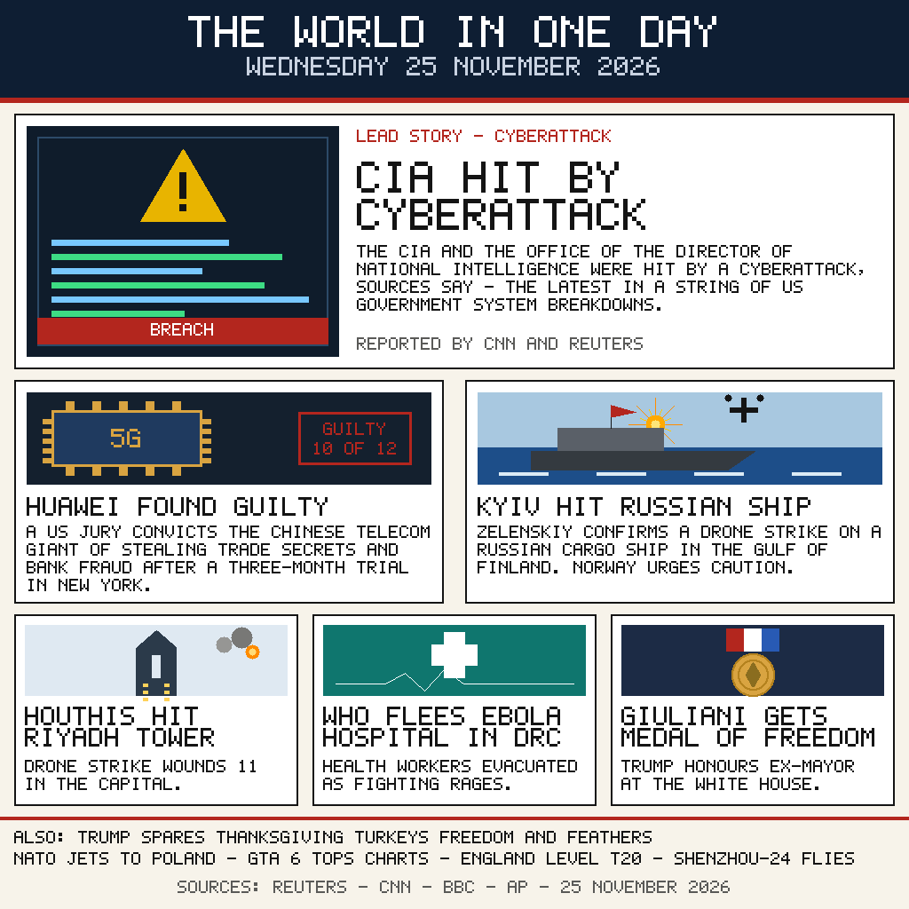

# Wednesday 25 November 2026 — The World in One Day

[](https://make.fun/bounty/news-image-20261125?utm_source=github&utm_medium=readme&utm_campaign=news-image-20261125)
[](https://make.fun/bounty/news-image-20261125/leaderboard?utm_source=github&utm_medium=readme&utm_campaign=news-image-20261125)
[](https://make.fun/bounty/news-image-20261125?utm_source=github&utm_medium=readme&utm_campaign=news-image-20261125)

## About

An entry for the make.fun competition
[Sum up 25 November's world news in one image](https://make.fun/c/news-image-20261125).
The program draws the image itself: `main.ts` (Node 22, standard library only)
is a from-scratch 1024x1024 rasterizer — hand-built 5x7 bitmap font, flat
pictograms, and a hand-written PNG encoder — that writes `entry.png` to
`$MAKEFUN_OUTPUT_DIR` (or `/output`). No network, no randomness, no timestamps:
both graded runs produce identical bytes. No generator script, no copied image.

The front page sums up real headlines reported on 25 November 2026:

1. **Lead — CIA hit by cyberattack**: the CIA and the Office of the Director
   of National Intelligence were hit by a cyberattack, sources say.
2. **Huawei found guilty**: a US jury convicts the Chinese telecom giant of
   stealing trade secrets and bank fraud after a three-month trial.
3. **Kyiv hit Russian ship**: Zelenskiy confirms a drone strike on a Russian
   cargo ship in the Gulf of Finland; Norway urges caution.
4. **Houthis hit Riyadh tower**: a drone strike wounds 11 in the capital.
5. **WHO flees Ebola hospital in DRC**: health workers evacuated as fighting
   rages; Ebola has killed 5,775 in the country's worst outbreak.
6. **Giuliani gets Medal of Freedom**: Trump honours the ex-mayor at the
   White House.
7. **Ticker**: Trump spares Thanksgiving turkeys Freedom and Feathers; NATO
   jets to Poland; GTA 6 tops charts; England level the T20; Shenzhou-24 flies.

## Run it

```sh
mkdir -p out && MAKEFUN_OUTPUT_DIR=out node main.ts
```

## The image


